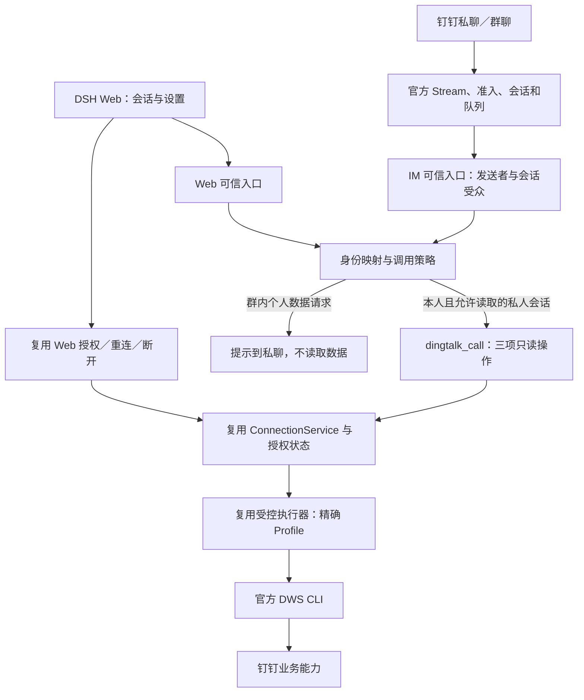

> 历史方案：开发已基于官方完成迁入；当前仓库布局、提交流程和验收边界以 [维护说明](../dsh-dingtalk/docs/REPOSITORY.md) 为准。

# dsh-dingtalk 官方 Fork 改造方案 v2.0

日期：2026-11-02　状态：待评审，仅方案，未执行 fork 或代码迁移。

本方案采用 **fork 官方主分支，在官方连接器内加入现有 Web 授权、受控数据工具和身份衔接能力** 的路线。最终维护一个插件包，支持 DSH Web 与钉钉私聊／群聊两个入口。已有开发成果按模块迁移，已有验证保留为基线，新增链路重新验收。

## 1. 本次建议确定的方向

| 决策 | 建议 |
|---|---|
| 代码主体 | 官方 `DingTalk-Real-AI/dsh-dingtalk` 的 `main`，保留 Git 历史和上游关系 |
| 开发方式 | 在自己的 fork 中增加增强模块，官方已有消息通道、会话、队列和诊断尽量直接使用 |
| 用户安装 | 一个插件包；消息接入与个人数据连接可以分别启用 |
| 使用入口 | DSH Web、钉钉私聊、钉钉群聊均保留 |
| 首版用户范围 | 一个已核验操作者、一个个人 DWS 授权账号；其他群成员不能借用此账号 |
| 首版数据能力 | 本人信息、日程、文档搜索，继续使用现有三项受控只读操作 |
| 授权体验 | 安装后在 Web 点击连接并完成钉钉授权；普通用户不手填 JSON |
| 群聊边界 | 群内可与 DSH 对话；个人 DWS 数据在私聊查询，首版不自动跨会话转发结果 |
| 暂缓范围 | 企业多用户、Cellgent 接入、业务写操作、数字员工身份整合 |
| 交付规则 | 本地验证后推送开发分支；用户明确提出时再建 PR |

以上是本方案的首版范围建议，尚未执行。尤其“单人双入口”和“群聊个人数据转私聊”是为了使身份、权限与体验有明确验收边界，不代表官方已经提供这些约束。

## 2. 评估依据与现状

### 2.1 已核实的代码基线

| 项目 | 基线 |
|---|---|
| 官方主分支 | `137ea79505e6317d98c1db643f0fbae138e016c8`，本次通过 GitHub 查询 `main` 确认 |
| 我们的实现 | `wanyexin1998/dsh-plugin`，`b11df21abd85a7011eac1d85c60063912eca2e31` |
| 当前开发分支 | `fix/dsh-dingtalk-query-feedback` |
| 当前插件版本 | `0.1.0-dev.6` |
| 已有 DSH 验证版本 | `0.2.1-rc.5` |
| 已有 DWS 锁定版本 | `1.0.66`，提交 `f215043e676d6889e1ddce3464828d8b1ec40c31` |

实施时重新确认官方 `main`。如果它已有新提交，先审查差异，再记录实际采用的 SHA；不在开发和验收中浮动跟随 `latest`。[官方主分支基线](https://github.com/DingTalk-Real-AI/dsh-dingtalk/commit/137ea79505e6317d98c1db643f0fbae138e016c8)

### 2.2 官方能直接承担的部分

官方连接器负责钉钉消息进入本地 DSH，包括 Stream 收发、私聊／群聊、会话、队列、取消、管理员审批、文件通道和诊断。运行依赖本地 DSH 在线。其支持范围以 Web profile 为主，Windows 标为实验性，因此本机兼容性要先验证。[官方说明](https://github.com/DingTalk-Real-AI/dsh-dingtalk/blob/137ea79505e6317d98c1db643f0fbae138e016c8/README.zh-CN.md)

官方当前的可选 DWS 集成主要检查本地 CLI 和登录状态、注入环境、挂载通用 Skill；它没有提供我们现有的 Web 授权面板，也没有自动按照每条消息的发送者选择个人 DWS Profile。其包清单目前没有 Web Client 声明。[DWS 集成代码](https://github.com/DingTalk-Real-AI/dsh-dingtalk/blob/137ea79505e6317d98c1db643f0fbae138e016c8/src/tools.ts)、[包清单](https://github.com/DingTalk-Real-AI/dsh-dingtalk/blob/137ea79505e6317d98c1db643f0fbae138e016c8/package.json)

因此，现有授权与 Web 体验有明确复用价值，不能因为采用官方仓库就直接删除。

### 2.3 已有成果的验证程度

- dev.6 已有报告记录本地测试 **38/38 通过、0 跳过**，类型检查通过；本次方案阶段未重新运行测试。[测试报告](E:/Code/dsh-plugin/dsh-dingtalk/docs/evidence/query-feedback/tests-report.json)
- 已有浏览器 Harness 验证原卡片更新、重复授权提示合并、成功／普通失败行内展示、浅暗色和窄屏布局。[浏览器报告](E:/Code/dsh-plugin/dsh-dingtalk/docs/evidence/query-feedback/p0-browser-report.json)
- 已有真实证据包含一个已授权账号的一次中文文档查询成功，查询后连接仍有效；没有采集业务内容。[真实读取报告](E:/Code/dsh-plugin/dsh-dingtalk/docs/evidence/query-feedback/real-read-report.json)
- 企业未开通账号、完整权限失败分类、全部真实 LLM 流程及 Desktop 等仍有待验收项。旧 P0 总表是 dev.4 历史记录，迁移时需要形成新的状态表。[旧验收矩阵](E:/Code/dsh-plugin/dsh-dingtalk/docs/P0-ACCEPTANCE.md)

这些证据用于证明旧功能及复现已修复问题，不能直接算作 fork 新版本通过。

## 3. 用户最终如何使用

### 3.1 在 DSH Web 使用

1. 安装我们的 fork 插件，进入 DSH Web。
2. 在设置中点击“连接”；首次使用自动准备已校验的 DWS，打开钉钉授权页。
3. 用户自行授权，Host 在线核验真实企业和用户，保存精确绑定。
4. 设置显示“已连接”，之后直接查询本人信息、日程和文档。
5. 会话里首次遇到未授权需求，只出现一张简洁连接提示；授权完成更新原提示。

已有消息机器人尚未配置、断线或被停用，不应妨碍 Web 的个人数据功能。已安装但未连接 DWS，也不应妨碍已配置机器人的普通聊天。

### 3.2 在钉钉私聊使用

1. 管理者完成官方机器人接入流程：应用配置、消息权限、Stream 和管理员绑定。
2. 用户在已认证的 Web 中发起“关联钉钉”，在机器人私聊完成短期配对，并完成官方身份对应关系核验。
3. 配对后，私聊请求使用与 Web 相同的个人授权绑定；不再重复要求 DWS 登录。
4. 未配对、账号不符或数据授权失效时，给出一次简短指引；不自动借用本机默认账号。

**机器人接入和个人授权是两件事。** 自建企业内部应用的管理者仍需完成一次应用配置；复用官方向导，凭据在本机私密步骤输入，不让普通用户编辑 JSON，也不把应用 Secret 当作个人登录凭证。

在手机钉钉中点击 `127.0.0.1` 会访问手机自身，不能据此完成电脑上的 loopback 授权。因此首版本机部署明确引导用户在运行 DSH 的电脑 Web 页面完成个人授权。远程 HTTPS 授权属于后续部署能力。

### 3.3 在钉钉群聊使用

- 仅在已启用的群、按官方群触发规则响应；首版只有已配对操作者可发起 Agent 任务。
- 普通问题在群内回复，使用独立群会话，不共享私聊或 Web 私人对话历史。
- 请求本人日程、文档等 DWS 数据时，群会话不执行读取，简短提示“请到私聊查询”。用户在私聊重新发起或确认。
- 群内提示不复述文档标题、日程、搜索词或个人查询结果。
- 首版不承诺自动转私聊。官方现有文字回复基于原会话，自动定向私聊需要新增投递、独立私人会话和失败处理，放在后续体验增强阶段。[官方回复接口](https://github.com/DingTalk-Real-AI/dsh-dingtalk/blob/137ea79505e6317d98c1db643f0fbae138e016c8/src/reply-sink.ts)

群聊是否允许读取共享资料以后可以单独开放；不能仅因发起者有阅读权限，就把个人搜索结果判定为全群可见。

## 4. 总体架构



架构上采用一个 fork 包、一个个人数据服务，入口适配分别负责可信身份和展示。普通消息收发继续走官方连接器，个人 DWS 操作只走受控服务。

身份统一不要求把三个入口合并成一个聊天记录。**账号授权共享，私聊、群聊和 Web 会话按受众隔离。** Web 可以查看有权查看的 IM 会话，但从群记录继续私人任务时应进入新的私人会话，不能改变原群任务的投递范围。

## 5. 身份与授权设计

### 5.1 明确四种身份

| 身份 | 含义 | 不能直接替代什么 |
|---|---|---|
| Web Host Owner | 当前本机 DSH 认可的浏览器操作者 | 不是企业 SSO 身份，也不自动证明某个钉钉员工身份 |
| 钉钉消息发送者 | 经平台通道收到的发送者、来源应用和企业范围 | 不是本机 DWS 当前登录账号 |
| 机器人管理员 | 允许管理机器人和审批的 owner | 不等于每位聊天用户的数据授权 |
| DWS 授权账号 | 在线核验的 `corpId + userId` 和对应 Profile | 不是群身份，也不能由模型指定 |

普通机器人中的 `senderStaffId`、数字员工中的 `OpenDingTalkId`、DWS `userId` 保留各自类型与作用域。相同字符串、昵称或头像都不能作为匹配证据。官方 owner 机制可复用，但需补数据身份映射。[官方 owner 实现](https://github.com/DingTalk-Real-AI/dsh-dingtalk/blob/137ea79505e6317d98c1db643f0fbae138e016c8/src/owner.ts)

### 5.2 新增内部绑定记录

下列是拟定的服务端模型，不是用户需要填写的配置，也不是模型参数：

| 记录 | 主要内容 |
|---|---|
| 操作者 | 内部 `principalId`、本机部署范围、状态 |
| 入口绑定 | 绑定 ID／版本、来源类型、机器人账号、经核实的企业／应用范围、外部 ID 类型与值、核验依据、有效状态 |
| 数据绑定 | `credentialBindingId`、精确 DWS 账号与 Profile 引用、状态、绑定版本 |
| 会话受众 | 入口、会话标识、私人／群内、允许使用的工具策略 |
| 调用上下文 | 本轮调用的操作者、入口绑定 ID／版本、数据绑定版本、受众、requestId、取消信号 |

映射层只保存身份引用与核验信息，不复制 Token。对外 UI 返回脱敏展示信息，内部 ID 和 Profile 不进入模型参数。

### 5.3 绑定流程及必须验证的依赖

1. Web 已认证操作者发起短期配对；私聊通道证明操作者控制相应 IM 账号。挑战一次性使用、短期有效，不允许从群聊完成配对。
2. 根据机器人应用及平台返回的可信身份信息，核验其与 DWS `corpId/userId` 的关系。
3. 优先使用适用于目标应用的官方身份查询／转换接口；具体接口、所需权限及返回字段在身份验证任务中实测确定，不提前假定 staffId 与 userId 通用。
4. 只有企业、ID 作用域和对应关系都成立，才允许此 IM 主体调用个人 DWS。
5. 若接口或权限不足，显示“身份待核验”并阻断 IM 个人数据调用；Web 个人查询仍可用。

短期挑战只能证明两个入口的控制关系，不能单独证明两端属于同一个钉钉账号。首版不把“由本人确认”悄悄变成跨账号委托授权。

### 5.4 每次工具调用如何选账号

可信入口先解析调用者和会话受众，然后由服务端取得其数据绑定，最后调用固定操作。模型仍只提供 `operationId + args`，不能传 `principalId/userId/profile/收件人`。

调用上下文必须绑定到具体 Agent 执行轮次，不能使用全局 `currentSender`。排队、并入消息、重启恢复、Web 续聊都要重新校验上下文。官方 Bridge 存在复用活跃 Agent 的路径；增强模式默认不跨私人／群聊受众复用 Agent，未证明能保留调用上下文的恢复路径应拒绝个人数据调用。[官方 Bridge](https://github.com/DingTalk-Real-AI/dsh-dingtalk/blob/137ea79505e6317d98c1db643f0fbae138e016c8/src/bridge.ts)

### 5.5 连接、配对、通道分别管理

| 操作 | 影响 |
|---|---|
| 断开个人数据 | 同时阻断 Web 与已配对 IM 的后续 DWS 调用；精确处理该数据 Profile |
| 解除 IM 配对 | 阻断此 IM 入口的数据调用，保留 Web 个人授权 |
| 停用机器人 | 停止消息接入，保留 Web 与个人数据绑定 |
| 取消本次重授权 | 终止当前事务；未破坏既有凭据时保留原有效连接 |
| 换账号／换企业 | 明确重新绑定，旧身份映射失效，不能静默继承 |

撤销先关闭新调用、取消排队及在途任务，再处理精确凭据。任务完成和最终投递前复核绑定版本；迟到结果不能恢复权限。注销失败保持阻断并说明可重试，不能显示为完全撤销。已经发送的历史消息不承诺自动撤回。

解除 IM 配对、停用发送者或换绑时，即使 Web 数据授权仍有效，也要递增入口绑定版本并取消该入口任务。执行工具和最终投递同时核对入口与数据两个绑定的有效性，避免旧 Agent 沿用已经失效的配对。

### 5.6 多用户扩展边界

首版拒绝第二位操作者借用当前授权。企业多人版需要增加 Web 用户认证、每用户凭据及执行隔离、独立队列与授权事务、人员停用联动，之后才可开放给多人。

Windows 下不同配置目录或会话不等于 DWS 凭据隔离；同 OS 用户的任意 shell 也可能访问同用户凭据。后续应采用经过验证的隔离执行单元或受控凭据服务，保留原方案的 Cellgent／Connector 扩展方向，不在本次 fork 首版顺便实现。

## 6. 保留已有开发内容的具体方式

以下源路径均位于现有 `E:\Code\dsh-plugin\dsh-dingtalk`，迁移不包含其他插件。

| 现有资产 | 迁移处理 | 必须保留的行为 |
|---|---|---|
| `src/shared/*` | 迁入增强模块，增加内部上下文接口 | 三项操作、参数校验、稳定状态／错误码、公开 DTO 脱敏 |
| `src/adapters/local/*` | 优先直接迁移逻辑，适配上下文及版本 | 精确 Profile、静态 argv、无 shell、排队、取消、超时、输出上限、执行前二进制校验 |
| `src/adapters/local/index.ts` | 保留真实问题修复 | 文档顶层 `documents` 响应兼容；普通查询失败不清除有效授权 |
| `src/host/oauth.ts` | 保留为薄授权适配层 | state/cookie/TTL/一次性消费、回调别名兼容、取消与重放防护 |
| `src/host/bootstrap.ts` | 保留并整合安装状态 | 无 JSON 点击连接、固定来源、下载及可执行文件摘要校验 |
| `managed-connection.ts`、`binding-store.ts` | 重构单例边界 | 精确绑定、在线核验、重授权与撤销语义，增加入口身份及绑定版本 |
| `src/host/index.ts`、`tool.ts` | 改为官方包中的增强装配 | Web 与 IM 使用同一服务，工具从可信上下文获得身份 |
| `src/host/ui-rpc.ts` | 按选定 DSH 版本复核后接入 | 浏览器 Owner、严格请求大小／信封、二次确认等边界 |
| `src/client/*` | 迁移 Web Client | 克制面板、原卡更新、每会话去重、刷新合并、成功行内展示 |
| `privacy.ts`、`private-settings.ts` | 保留约束，重新验证实现 | 不泄露凭据和正文；状态目录稳定；不修改未知用户目录 |
| `skills/dingtalk-readonly` | 随新包保留并适配 | 正确选操作、有限重试、业务失败不引导重授权 |
| `tests/*` | 纳入新仓库回归集 | 保留已修复问题及负向测试，不因换目录而丢失 |
| `scripts/verify-*` | 合并进入官方 CI 的增强检查 | 区分单测、合成服务、浏览器、官方 Web 和真实授权证据 |
| `docs/evidence/*`、G0 脚本 | 带原版本归档 | 作为迁移前基线与复现工具，不冒充新架构验证 |

两处实现不能机械复制：当前七条精确 RPC 路由包含 DSH `0.2.1-rc.5` 的适配处理；当前 DWS 日志防护利用插件自有目录中的 `logs` 文件触发 no-op logger。它们均须对目标版本重新验证，尤其不能把关闭日志的办法用于要求本地审计的数字员工运行链路。

旧包的独立装配、重复安装检查和重复发布入口，在新包功能等价验收通过后再停止维护。OAuth、Web UI 和受控执行器没有被官方等价覆盖之前继续保留。不预先用一个代码复用百分比代替模块验收。

## 7. 官方代码需要改哪些位置

官方源码已有入口准入、Agent 作用域工具注册和消息处理钩子，可以接入增强功能，无需重写整个消息桥。[入口代码](https://github.com/DingTalk-Real-AI/dsh-dingtalk/blob/137ea79505e6317d98c1db643f0fbae138e016c8/src/index.ts)、[Host 工具接口](https://github.com/DingTalk-Real-AI/dsh-dingtalk/blob/137ea79505e6317d98c1db643f0fbae138e016c8/src/host.ts)

| 官方位置 | 拟改内容 |
|---|---|
| `src/index.ts` | 装配增强服务，在消息准入后接身份和受众策略；让未配置机器人不影响 Web 数据功能 |
| `src/stream.ts` 及消息类型 | 保留身份类型、来源机器人、经核实的企业／应用范围 |
| `src/bridge.ts`、`src/host.ts` | 注册受控工具、携带本轮上下文、隔离会话受众、处理取消及恢复 |
| `src/owner.ts` 周边 | 复用管理员／发送者准入，增加数据身份核验，避免把 owner 等同 DWS 用户 |
| `src/tools.ts` 周边 | 增强模式不启用官方通用 DWS Skill 和进程级应用凭据导出 |
| setup／doctor／配置 | 集成个人数据状态、配对状态及恢复指引；继续使用官方向导和诊断框架 |
| 包清单／构建／patch | 增加 Web Client、增强模块、资源与测试；统一打包 |

fork 新安装默认仅允许 owner；群聊只对用户明确启用的群开放。已有官方安装的宽松聊天配置不能自动成为个人数据使用许可，数据入口仍需单独通过配对与身份核验。

建议新增目录如下，名称为规划，尚未创建：

```text
src/
  …官方现有模块
  enhancements/
    identity/       入口身份、配对、可信调用上下文
    connection/     迁入授权、绑定与连接状态
    execution/      迁入受控 DWS 执行器
    client/         迁入 Web 设置与会话展示
    shared/         迁入契约、校验和错误码
test/
  …官方原有测试
  enhancements/     迁入及新增回归
docs/
  enhancements/     产品、迁移、验收及上游差异说明
```

目录调整后同步测试发现规则，确保嵌套测试确实被 CI 执行。尽量不搬动官方原有文件；上游必要改动集中为少量装配和策略接点，便于后续同步。

### 7.1 工具与群聊限制必须在运行时生效

关闭通用 DWS Skill 只是减少重复能力，不能限制仍然存在的任意 Bash／代码执行。需要验证 DSH 的 Agent 工具集约束，给 IM 数据任务配置明确的允许工具集；不能仅靠提示词承诺只读。

群聊使用独立的受限 Agent，不挂载能读取私有历史、凭据或任意本机文件的通用执行能力，也不直接复用私人 Agent。现有文件收发可以在本人私聊按官方边界保留；群内发文件需另有明确共享范围。若目标 DSH 版本不能实施这些约束，必须先补可信执行边界，不能在身份验收未通过时开放个人 DWS 到 IM。

本机 Web 的完整开发 Agent 仍属于操作者的 OS 信任域。这里的三项只读保证针对我们的受控工具；不宣称约束本机用户主动运行的所有命令。

### 7.2 数字员工能力的处理

保留官方数字员工源码和原测试，首版不开启该运行模式、不纳入统一个人身份承诺。它有独立的精确 Profile、operator、绑定版本、租约及强制审计协议，不能直接用普通机器人配对替换。[数字员工协议](https://github.com/DingTalk-Real-AI/dsh-dingtalk/blob/137ea79505e6317d98c1db643f0fbae138e016c8/docs/digital-employees.md)

## 8. 交互与文案约定

设置中使用一个紧凑“钉钉”分区，以少量行分别展示个人账号和消息接入状态。身份未核验时再出现配对操作，不铺开多张大卡片。

- 个人账号：未连接／连接中／已连接／已失效。
- 消息接入：未接入／在线／离线；与个人授权状态独立。
- 按钮沿用平面图标和短文字：“连接”“重连”“断开”“配对”；刷新／收起保留图标。
- Web 授权提示沿用现有紧凑尺寸策略，最大宽度不超过现有约 420px 基线，窄屏自适应。
- 已连接、失败、失效更新原提示；同一会话不反复追加连接卡。
- 查询成功由模型正常回答，工具状态只占一行；普通查询失败也行内展示。
- 钉钉查询结果默认文字或 Markdown；需要审批时继续使用官方交互组件，控制文字量，不新增“查询完成”结果卡。
- 钉钉无法更新原消息的场景，采用一次简短状态提示及去重，不用连续卡片补偿。
- 授权完成后不模拟用户发送消息。只有验证过的原生只读任务恢复机制才能自动继续，否则提供清楚的继续方式。

“已连接”只能来自 Host 对授权状态的确认，不能根据模型回复、前端消息或一次普通业务错误猜测。

## 9. Fork、包名和上游维护

实施阶段建议 fork 到 `wanyexin1998/dsh-dingtalk`，本地放在独立目录 `E:\Code\dsh-dingtalk-official`；名称及路径实施前检查冲突。现有 `E:\Code\dsh-plugin` 保持完整，继续作为旧版本和迁移来源。

- `upstream` 指向官方仓库，`origin` 指向自己的 fork。
- `main` 保留上游基线，定制集成在 `develop`；具体任务使用新的 `feat/*` 或 `fix/*` 分支。
- 不把整个旧单仓的提交直接合并进官方仓库。按文件迁移 `dsh-dingtalk` 模块，并记录来源提交、原路径和新路径。
- 上游更新先进入单独同步分支，审查身份、工具、DWS 协议与构建变化，再跑两组回归；不在用户机器自动追最新版本。
- 维护差异清单：修改原因、涉及上游文件、对应测试、未来是否可由上游能力替代。
- 本阶段与后续默认只推自己的开发分支，不自动建 PR、合并或发布。

发布包使用自己的 npm scope，例如 `@wanyexin1998/dsh-dingtalk`，实际名称待实施确认。开发阶段使用本地 tarball，不需要先公开发布。保留必要的 CLI 接口兼容性，同时阻止同一 DSH Profile 同时安装官方包和 fork 包产生双通道／重复工具。

需要统一检查 setup 自安装、升级、恢复命令、文档及包内常量，确保指向我们的包和已验证版本。继承的 npm 自动发布配置先保持禁用或改成手动流程，避免推开发分支时发布到错误命名空间。

保留官方 A2UI 子路径导出，并同步修改测试、打包检查中的硬编码包名，包括 `scripts/check-pack.mjs` 的 A2UI 导入；不能只改 `package.json` 就认为包名迁移完成。

保留上游 MIT 版权和许可声明、`THIRD_PARTY_NOTICES.md`，以及迁入模块和 Skill 的原有第三方声明；产品说明标明基于官方项目的定制版。[官方许可](https://github.com/DingTalk-Real-AI/dsh-dingtalk/blob/137ea79505e6317d98c1db643f0fbae138e016c8/LICENSE)

## 10. 旧数据迁移与回滚

更换包名、Host ID 或 DSH Profile 可能改变状态路径，因此状态迁移单独交付，不能只复制源码后要求用户全部重配。

1. **迁移前清点**：只记录版本、包、状态路径及绑定是否存在，不输出凭据或用户业务内容。
2. **兼容引用**：新实现通过版本化迁移记录，继续引用旧绑定及其精确 DWS Profile；先在原配置／凭据边界内做只读在线核验。
3. **不复制密钥**：不导出 DPAPI／Keychain，不把 Token 写入新 JSON。状态引用可以迁移，凭据由 DWS 继续管理。
4. **明确采用**：识别到旧绑定时，用户在本机页面确认继续使用该账号；通过核验才启用。失败保留旧目录，提示重新连接。
5. **单实例切换**：合成测试使用隔离凭据环境；真实迁移期间不让新旧实例同时消费同一机器人消息或修改同一授权。
6. **回滚**：保留旧 tarball、安装清单和原状态路径；停止新通道后恢复旧版本与其配置，再只读核验。

回滚代码不能恢复已经在平台撤销的授权；如果用户已明确注销，回旧版本也需要重新授权。卸载 fork 默认不等于注销所有 DWS 账号，更不能批量删除用户目录或其他 Profile。

本地撤销决定也必须保留：回滚不能用旧快照覆盖最新的 `revoked/revocationPending` 或入口解绑记录。即使平台注销失败、在线查询仍成功，也不能自行恢复已撤销的使用许可。若旧版本不能识别这些状态，禁止带有效旧绑定恢复运行，必须保持断开并由用户重新授权；IM 重新启用还需重新核验配对。

## 11. 实施任务与阶段出口

下列使用方案内任务编号，尚未在 GitHub 创建新 Issue。已有 #4–#13 的成果按最后一列承接，不重复从零开发。

| 任务 | 主要交付 | 完成条件 | 承接旧成果 |
|---|---|---|---|
| M0 基线与兼容性 | fork、固定 SHA、隔离开发目录、上游测试及 Windows 安装报告 | 原官方包在选定 DSH 上可安装／启动／卸载；选定兼容版本组合 | #4、#5、#13 的版本锁和安装验证 |
| M1 单包装配 | 增强模块、Web Client、统一构建和配置 | 未配机器人时 Web 数据模块可加载；未连 DWS 时普通消息仍可用 | #5、#9、#10、#13 |
| M2 数据能力迁入 | OAuth、执行器、三操作、错误分类和既有 UI | 旧行为逐项等价；38 项旧测试映射进入新测试集并重跑 | #6–#11 及 dev.5／dev.6 修复 |
| M3 可信身份衔接 | 配对、官方 ID 对应关系验证、上下文／工具限制 | 同人匹配成功，错人／跨企业／错误 ID 类型拒绝；不依赖默认 Profile | #7、#12，加本次新能力 |
| M4 两入口联通 | 私聊受控工具、群聊策略、状态同步、取消和防重复 | Web／私聊使用同一精确账号；群中不产生个人数据读取与结果历史 | #8–#11，加本次新能力 |
| M5 状态迁移 | 原绑定采用、版本化迁移、切换／回滚说明 | 可从旧版切换并验证回滚；不破坏其他 Profile | #7、#13 |
| M6 联合验收 | 本地回归、真实账号与消息、受众／身份复核、最终报告 | 第 12 节门禁逐项有证据；未通过项明确保留 | #4、#12、#13 |

依赖顺序：M0 → M1 → M2；M3 的官方 ID 可行性验证在 M0 后尽早进行，避免最后才发现匹配不可用。M2 和 M3 完成后进入 M4，M5 在真实切换前完成，最后 M6。

实际改造量属于**中等集成改造**：消息通道不用重写，现有数据功能能迁入；新增工作集中在身份、会话受众、Agent 工具约束和统一安装。这比只换依赖大，但无需重做已实现的授权和查询能力。M0／M3 验证完成后再估算开发工期，不把未知接口当作已解决。

## 12. 验收矩阵

| 场景 | 必须观察到的结果 | 证据方式 |
|---|---|---|
| 新安装 | 安装一个包，Web 可见；无需用户手写 JSON | 真实打包安装与浏览器 |
| 官方基础回归 | 消息、队列、取消、管理员审批及启用的文件能力无回归 | 上游测试＋实际私聊／群聊 |
| 首次个人授权 | 官方授权页 → 正确回调 → 在线身份 → 原页面状态更新 | 用户操作＋脱敏报告 |
| 回调边界 | 相同 code/authCode 可处理；冲突、重放、过期被拒绝 | 合成回调测试 |
| Web 查询 | 本人信息、日程、文档三种中文意图选对操作 | 真实 LLM＋只读结果状态 |
| 两入口同人 | Web 与私聊解析到相同已验证数据绑定 | 服务端受限核验，公开报告仅标记 match |
| 身份不符 | 他人私聊、同群他人、跨企业或 ID 类型错配均不能调用本人数据 | 负向夹具＋真实第二账号 |
| 同时与恢复 | Web／IM 排队、重启恢复、活跃 Agent 复用不串上下文 | 并发及生命周期回归 |
| 群聊个人请求 | 不执行个人读取；群日志／Agent 历史中没有私人结果 | 工具调用计数＋受控日志断言 |
| 工具绕行 | 模型不能通过 profile 参数或群内任意 shell 访问个人 DWS | 工具集与运行边界测试 |
| 状态与 UI | 设置已连接时不重复发授权卡；失败不冒充未授权；成功行内展示 | 浏览器＋实际会话 |
| 撤销与迟到结果 | 数据撤销影响两入口；解除配对只失效该 IM 入口；对应排队取消、旧结果不再投递；其他 Profile 不受影响 | 本地回归＋真实精确解绑 |
| 企业拒绝 | 未开通／scope 不足有证据支持的分类；未知原因保持未知 | 真实受限账号或明确官方夹具 |
| 迁移／回滚 | 旧绑定可核验采用；旧版可恢复；撤销失败或解除配对后回滚也不恢复旧权限 | 隔离迁移演练 |
| 打包与隐私 | 无凭据、回调码、业务正文进入包／仓库／诊断输出 | 归档检查＋脱敏回归 |

验证分层保留：上游测试、我们的模块测试、官方 DWS＋合成端点、浏览器 Harness、正式 DSH Web、真实钉钉账号／消息。每份报告记录确切插件、DSH、DWS 版本及模拟／真实分类。

首版主要验收 Windows x64＋DSH Web＋钉钉客户端；不因为上游支持其他平台就宣称我们的增强层跨平台通过。Desktop、macOS/Linux 增强功能、多用户和数字员工另列覆盖范围。架构复核不能替代最终候选的安全验收。

真实联调最后由用户提供测试准备情况并自行操作授权，所需账号包括本人和用于验证拒绝的第二账号；不通过聊天发送 Secret、Token 或授权码。需要机器人配置时给出明确的本机私密输入步骤。

## 13. 版本完成后的交付物

1. 基于官方 `main` 的 fork 开发分支、上游基线记录和可追溯迁移清单。
2. 一个可安装 tarball，包含官方消息通道及我们的 Web／数据增强模块。
3. 统一安装、个人授权、机器人接入、配对、升级、断开和回滚文档。
4. 同人双入口、群聊限制、负向身份、迁移及真实联调的验收报告。
5. 上游差异与兼容版本清单；保留旧开发成果及历史证据。

首版完成后，再依次考虑自动转私聊、共享资料能力、企业多用户／Cellgent，以及数字员工模式。新增写操作独立设计目标确认、授权、去重和审计，不能随通用 DWS Skill 一并默认开放。

本次只新增这份方案文件；未 fork、未迁移源码、未安装或重启服务、未推送、未建 PR。
