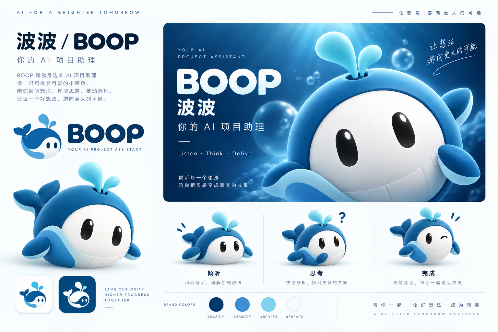
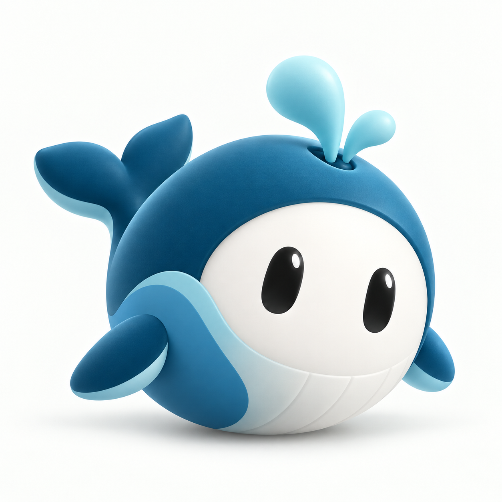

# BOOP（波波）视觉设计方案

> 版本：1.2 · 日期：2026-10-16 · BOOP 已确认视觉稿归档。  
> 收录用户已确认的 **KV / VI 品牌板** 与 **角色实体图**，作为本版视觉依据；Cellgent 图片保留为历史风格参考，不再占据 BOOP 主展示位。  
> 本次仅更新视觉文档与资产展示，不改变产品架构、Agent Loop、任务看板复用或权限策略。两张图均为 PNG 图像，不是可编辑矢量文件或三维模型源文件。

## 00｜已确认的 BOOP 视觉稿

### 00.1｜KV / VI 品牌板

**图 V01 · 已确认视觉稿。** 包含主 KV、BOOP / 波波字标、蓝鲸角色、倾听／思考／完成状态示意、图标与配色展示。原图 **1536 × 1024 px，RGB PNG**，在交接包中原样保存。

适用于方案封面、项目介绍和品牌视觉说明。它是一张综合展示板，不等同于全部 VI 资产已经拆分完成；板内 Logo、字标与状态图仍需后续制作独立可编辑文件。

### 00.2｜角色实体图

**图 V02 · 已确认角色实体图。** 短圆蓝鲸、奶白腹面、黑色胶囊眼、短胸鳍、上扬尾鳍与双水滴构成当前角色识别。原图 **1254 × 1254 px，RGB PNG**，白色背景与地面阴影为画面的一部分，**不是透明底**。

适用于角色介绍、欢迎／关于页面中的大尺寸展示以及后续同形资产制作的参考。不得将其声称为三维模型、可旋转素材或已完成的透明母版。

### 00.3｜使用与版本规则

| 资产 | 当前状态 | 当前用途 | 后续独立交付 |
|---|---|---|---|
| KV / VI 品牌板 | 用户已确认；原图已入包 | 品牌介绍、方案展示 | 可编辑排版、不同画幅 KV |
| 角色实体图 | 用户已确认；白底原图已入包 | 角色介绍、同形制作参考 | 透明底、视角／状态延展 |
| 品牌板中的 Logo / 小图标 | 随整张图确认外观方向 | 识别方向参考 | SVG 母版、16/24/32px 适配 |
| Cellgent 参考图 | 历史风格依据 | 解释材质与构图来源 | 不作为 BOOP 正式角色分发 |

两张当前图保持原样，不在本轮裁切、换色或添加覆盖文字。阅读器可点击查看大图；文档中的图使用相对路径，连同 `assets/` 目录一起打开即可。

## 01｜品牌定位与视觉关系

名称：**BOOP / 波波**。当前已确认品牌板主文案为 **你的 AI 项目助理**；主题句为 **让想法游向更大的可能**，辅助节奏词为 **Listen · Think · Deliver**。

“记住每一步，陪你把事情做好”保留为产品说明中的备用文案，不替换已确认图中的文字。

用户面对的不是严肃指挥塔，也不是需要照料的电子宠物，而是一位可靠、温和、持续理解项目的助理。参考 Cellgent 的亲和力和材质语言，不搬用其绿色叶片标志，不复制 nanoMuse 或 DeepSeek-Bot 的角色。

两者采用“相近的设计语言、不同的角色识别”：Cellgent 是绿系细胞/叶片生命体；BOOP 是蓝系鲸鱼。字标、轮廓和角色必须能单独识别。不能把“绿色改蓝色”当作已经完成新的品牌设计。

## 02｜从参考中保留什么，改变什么

| 参考特征 | BOOP 的继承方式 | 明确不继承 |
|---|---|---|
| 圆润、柔软的一体形体 | 小型短圆鲸身，重心低，体块紧凑 | 原样照搬细胞球体与包裹叶片 |
| 奶白色面部与黑色眼睛 | 奶白腹面/脸部留白，双黑胶囊眼 | 人类五官、浓妆腮红、表情包夸张表情 |
| 细腻的立体材质和边缘高光 | 类磨砂软胶的视觉观感，柔和面积光，轻微颗粒 | 毛绒、镜面金属、荧光、透明玻璃主体 |
| 深色大圆角 KV 与浅色留白 | 深海蓝大画面，白色主字标，克制的信息层级 | 大面积绿底与直接复制宣传文案 |
| 多状态角色延展 | 倾听/思考/完成/待确认/离线可由同一角色变化 | 用悲伤、撒娇诱导批准 |
| Logo、App 图标、主角色成套 | 同一轮廓派生 3D、2D、单色、微尺寸版本 | 三维角色和小图标是两只不同的鲸鱼 |

以上是对用户给定图像外观的设计归纳，不是对参考角色实际建模材质的技术鉴定。

## 03｜三条应用层次

### A. KV：品牌主视觉

用于项目封面、GitHub 社交预览、发布介绍、首次展示。允许较大的 3D 蓝鲸、深蓝空间、侧逆光和轻微场景投影，品牌情绪充分但不繁杂。

主角色占画面视觉重心，采用三分之四视角或近景，并保留鲸鱼核心特征。本次品牌板中的文字已合成在 PNG 内；当前可整图展示，后续制作多尺寸宣传物料时再单独排版可编辑文字，不把 PNG 内的字形当作矢量母版。

### B. VI：可复用品牌识别

包括 Logo、字标、App/IM 头像、浅深背景、单色版、微尺寸版、色彩与排版规范、状态组合及安全区。VI 不是 KV 海报缩略图，需有独立的矢量母版。

### C. UI：产品内识别

原生 DSH 字体、输入框、侧栏和明暗主题保持不变。头像16–48px、适量品牌色，任务卡以内容为主。大面积 3D 角色只用于有价值的欢迎/关于场景，不常驻主聊天。

## 04｜BOOP 角色绘制简报

| 部位 | 方向 |
|---|---|
| 身形 | 一体、短圆、偏饱满；允许近球体体积，但仍有明确鲸鱼轮廓，不画成戴鲸鱼头套的普通机器人 |
| 脸/腹面 | 奶白大面积留白，与蓝色身体融合，不形成独立硬质面罩 |
| 眼睛 | 大小相近的两枚深色竖胶囊；KV 可有小面积柔高光，小图标去除高光 |
| 尾鳍 | 与后身清楚连接，可轻微上扬；尾鳍轮廓是关键识别，不被圆形裁切全部吞掉 |
| 胸鳍 | 短、小、圆润，作为倾听/完成动作的辅助，避免变成人类双手 |
| 水花 | 顶部1–2个圆润水滴，可形成品牌细节；不能照搬 Cellgent 叶芽，16px版可以省略 |
| 嘴与鼻 | 默认不添加，表情通过眼睛、姿态和辅助符号表达 |
| 姿态 | 稳定、轻微倾斜、好奇而可靠；不使用武器、耳麦、硬核控制台道具 |
| 材质 | 细腻软胶视觉观感、蓝色体块自然渐变、柔软白腹；不塑料刺眼、不毛绒化 |
| 光照 | 大面积柔光、适度轮廓光、自然接触阴影；不要同时出现多个矛盾高光方向 |

当前已确认角色图为白底 RGB PNG，保留其原有地面阴影。后续另行导出透明背景母版；主色形体和腹面应在不加地面阴影时仍然成立。若采用三维制作，三视图/转面必须保持尾部、胸鳍与水花连接的一致性；若采用生成式绘制，逐张进行同样的一致性核查。

## 05｜色彩系统：从细胞绿转向深海蓝

以下仍是 v1.1 已有的工程建议色，本轮不因为图片确认而自动改动 UI token。已确认品牌板中的色块、渐变和十六进制标签属于图像呈现；实际界面取色以本表与 `assets/boop-brand-tokens.json` 为准，后续规范化 VI 时统一校准。不得将角色图像像素色直接视为通过对比度验证的交互色。

| 名称 | 色值 | 用途 |
|---|---|---|
| 深海蓝 | #073F5C | KV背景、深色字标/单色图标 |
| 波波蓝 | #449BCC | 角色主色与品牌视觉，不作为白底小号正文默认色 |
| 浅浪蓝 | #ADDDEB | 高光、辅助图形、柔和腹面反光 |
| 珍珠白 | #F8F7F2 | 角色腹面、浅色品牌板，UI正文背景优先跟随宿主 |
| 深墨蓝 | #0B2637 | 品牌排版正文与大标题 |
| 交互深蓝 | #17648B | 白字按钮、白底链接与键盘焦点候选 |
| 轻蓝面 | #EAF5FB | 局部选中与辅助背景 |

KV 可以使用深海蓝至更深蓝的空间渐变。产品内不把所有组件染成相同蓝色；危险、待决、已验证成功继续用独立语义色。角色蓝不能被当成运行中或安全可信的凭据。

## 06｜KV 构图与文案

### 横版主 KV

左侧约40%为文案与字标，右侧约60%为角色近景，整体深海蓝大圆角画面。主体不堆叠模块卡片、技术框图、图标与功能列表。

推荐文字层次：

**BOOP**

**你的 AI 项目助理**

让想法游向更大的可能。

辅助英文沿用已确认图中的 **Listen · Think · Deliver**。当前主 KV 已包含在第 00 节品牌板中；今后的可编辑排版以此图作为视觉参考，不另换一种角色。

### VI 品牌展示板

已确认的 BOOP 品牌板继承 Cellgent 参考的层次：品牌定义、主 KV、独立角色示意、多状态延展、双色图标和配色。它是集中展示，不应整张搬进 DSH 日常聊天页面。当前角色图为白底，透明版另行制作。

### 竖版与头像适配

竖版保留同一角色，不把横版硬裁成看不见尾鳍的半张脸。IM/App 头像以清晰轮廓与眼睛识别优先；小尺寸不保留复杂噪点与地面阴影。

当前实际入包尺寸：品牌板 **1536×1024**，角色图 **1254×1254**。后续适配目标可采用主 KV 1920×1080、社交分享1200×630、品牌板1920×1280、角色母版2048×2048及方形应用1024×1024；这些是后续设计目标，不代表本轮已经交付这些分辨率，也不冒充平台强制规格。

## 07｜Logo、字标与微尺寸

3D 角色与2D标识先统一形状，再简化层次。2D母版保持身形、尾鳍/水滴、腹面和眼睛；单色版利用轮廓与留白，不依赖渐变才能识别。

16px：优先鲸身/尾部，省略水花细节和眼睛高光。24/32px：恢复双眼与腹面主要留白。64px以上可采用静态3D头像，但与同尺寸2D版本分别测试清晰度。

字标使用大写BOOP，圆角几何而不膨胀成儿童气球字。中文“波波”作为副字标。两个O不能简单改成两个眼睛而破坏读字；有识别收益再尝试，不作为强制设计。

安全区以图形高度10%为起点；真实导出后测试圆形和圆角方形裁切。不打包字体文件，不把现有系统字体说成独家品牌字体。

## 08｜角色状态与真实任务状态分离

| 角色表现 | 适用场景 | 状态证据 |
|---|---|---|
| 倾听 | 对话默认，等待你的输入 | 中性状态，无需表示任务正在运行 |
| 思考 | 正在处理当前问题 | 必须有真实模型活动，可一次轻微变化 |
| 完成 | 一次交付后的短暂表现 | 旁边明确“已交付/已验证”的实际状态 |
| 待确认 | 审批或恢复事项 | 中性姿态+文字/图标，不用委屈表情 |
| 离线/异常 | 模型或Host不可用 | 文案明确；无哭泣、抖动或持续闪烁 |

不把“开心鲸鱼”当作验收凭据。不因用户拒绝而降低亲和度或进行情绪诱导。工作区自动整理默认不驱动主头像持续动画。

## 09｜UI与任务看板应用

借鉴 dashi-taskboard 的内容密度、卡片/详情组织与交互，视觉仍由 BOOP 局部 token 与宿主主题适配控制。不能把它的全局body/reset、Codex Logo或独立聊天入口带进DSH。

任务卡标题与状态优先，头像仅用于执行来源/BOOP身份。表格、代码、金额与版本使用可读的宿主字体；蓝鲸不占据每张卡片。浅/深主题分别校验主色、警告和危险状态的对比度。

圆角：小控件8，业务卡12，局部大面板16为设计初值；宿主已有对应token时优先继承。KV大圆角与UI小圆角可以属于同一语言，但不强制统一数值。

## 10｜资产与发布边界

本轮已交付：**已确认 BOOP KV / VI 品牌板、已确认角色实体图，两份原始 PNG**；同步写入本册、阅读器视觉页和首页。本包还保留品牌/交互 token、来源台账和 Cellgent 历史参考。原 v1.0 扁平概念标继续标记 deprecated，不作为当前主角色。

| 文件 | 说明 |
|---|---|
| `assets/boop-kv-approved.png` | BOOP 品牌板原图，1536×1024，RGB PNG |
| `assets/boop-character-approved.png` | BOOP 白底角色实体图，1254×1254，RGB PNG |
| `assets/boop-visual-assets.json` | 原始文件名、尺寸、来源、确认状态与 SHA-256 |
| `references/` | Cellgent 历史风格参考，保持与 BOOP 资产分开 |

尚需独立制作的生产资产：透明角色图、完整状态/视角延展、同形2D主标、16/24/32微尺寸、单色深浅版、横向字标与可编辑 KV / VI 排版源文件。本轮的视觉确认不应被误写成这些文件均已完成。

用户给定 Cellgent 参考图仅作为本次设计依据保留；后续公开仓库前仍需确认这些参考资产是否可公开。BOOP 当前图像的来源记录为本次对话生成并经用户确认，不标注虚构的三维建模作者或源文件许可。

## 11｜视觉验收

角色必须一眼像鲸鱼，而不是绿色细胞换色；3D与2D在尾部、水花和腹面保持一致。KV以第00节已确认画面为依据，保留圆润角色、水下柔光与少量气泡；这些场景元素只用于品牌物料，不扩散到日常 UI 背景。

16/24/32像素、圆形裁切、明暗主题、200%文本缩放和减少动画分别核查。所有关键信息仍有文字或符号，不只靠颜色与表情。原Session外观不因BOOP或看板加载发生全局变化。

**品牌可以有立体温度，工作界面仍然简洁克制。**

### v1.2 本轮验收范围

本轮确认两张原图已正确嵌入文档与阅读器、保持比例、可查看大图，并随交接包提供原文件。微尺寸 Logo、透明图、三维源文件、实际 DSH UI 应用及插件运行验收不在本轮完成范围内。
