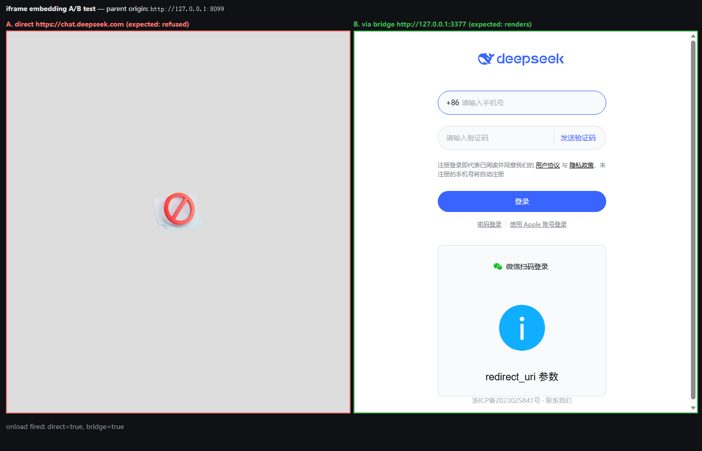
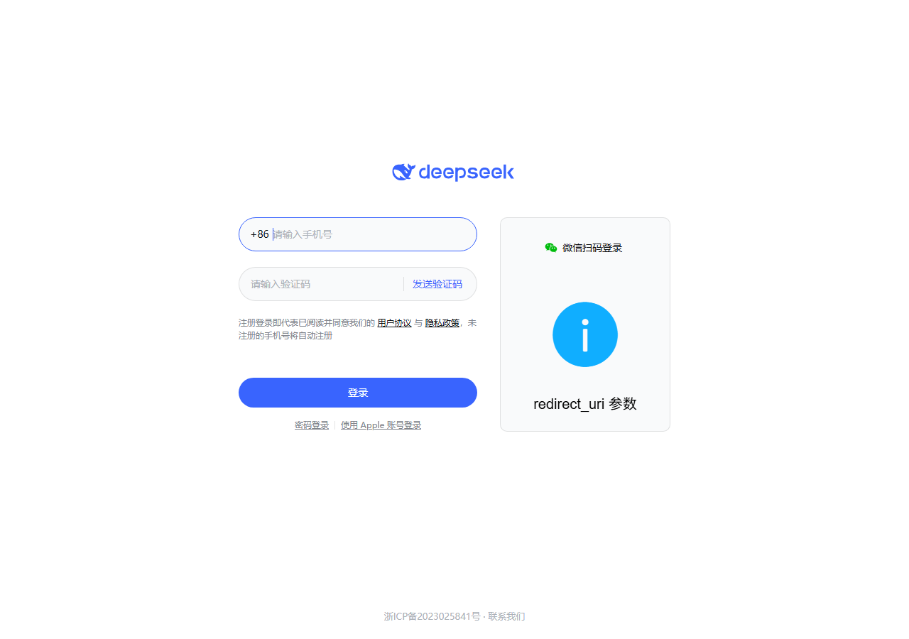

# PROXY EVIDENCE — loopback bridge for `https://chat.deepseek.com`

**Verdict: the bridge works.** All five required evidence items are green, and an end-to-end A/B browser
test proves the goal directly: in an iframe on a *different* origin, the real site is **refused**
(CSP `frame-ancestors 'none'`) while the bridged copy **renders the DeepSeek sign-in page**.

| | |
|---|---|
| Machine | Windows, `node v24.18.0`, `win32` |
| Bridge URL | `http://127.0.0.1:3377` (127.0.0.1 only) |
| Upstream | `https://chat.deepseek.com` |
| Date of evidence | 2026-10-10 (local), probe timestamps are UTC |
| Evidence collector | `node probe.mjs --port 3377` → raw output in [`proxy/probe-output.txt`](proxy/probe-output.txt) |
| Self-test | `node streaming.test.mjs` → 9/9 PASS, exit 0 |

## 0. Files and commands

| Path | What it is |
|---|---|
| [`proxy/proxy.mjs`](proxy/proxy.mjs) | The bridge. ESM, zero dependencies (`node:http`/`node:https`/`node:zlib`). Exports `createBridgeProxy(options)` (+ `startBridge` alias, `acquireBridgeProxy` singleton, `rewriteHtmlDocument`, `rewriteSetCookie`, `rewriteLocation`, `buildUpstreamHeaders`, `translateResponseHeaders`) and is a CLI when run directly. |
| [`proxy/probe.mjs`](proxy/probe.mjs) | Black-box evidence collector (items 1–5 + 8 extra sections). |
| [`proxy/streaming.test.mjs`](proxy/streaming.test.mjs) | Self-test against a controlled fake upstream: SSE chunking, port fallback, cookie/Location rewrite, gzip HTML rewrite, seed injection, POST/Host forwarding. |
| [`proxy/probe-output.txt`](proxy/probe-output.txt) | Raw stdout of the final probe run (209 lines). |
| [`proxy/selftest-output.txt`](proxy/selftest-output.txt) | Raw stdout of the final self-test run. |
| [`proxy/iframe-embed-test.html`](proxy/iframe-embed-test.html) + [`proxy/serve-test-page.mjs`](proxy/serve-test-page.mjs) | A/B iframe harness (parent origin `http://127.0.0.1:8099` ≠ bridge origin). |
| [`proxy/iframe-ab-test.png`](proxy/iframe-ab-test.png) | Screenshot of the A/B test (the headline proof). |
| [`proxy/rendered-via-bridge.png`](proxy/rendered-via-bridge.png), [`proxy/rendered-dom.html`](proxy/rendered-dom.html) | Headless render of the bridged page alone + its DOM. |
| [`proxy/node-exit-abort.repro.mjs`](proxy/node-exit-abort.repro.mjs) | Repro of a Node 24.18/Windows teardown abort that the bridge works around (see §11). |

**Start (exact):**

```powershell
cd E:\wyx_code\dsh-deepseek-chat-bridge\experiments\proxy
node proxy.mjs --port 3377
# BRIDGE_URL=http://127.0.0.1:3377
# BRIDGE_PORT=3377
# [bridge] listening on http://127.0.0.1:3377  ->  https://chat.deepseek.com
# [bridge] health: http://127.0.0.1:3377/__bridge/health
```

**Stop (exact, with verification):** `job_kill`-style termination of the launcher left the child `node.exe`
alive, so the process was stopped by PID and the port re-checked:

```powershell
$c = Get-NetTCPConnection -LocalPort 3377 -State Listen
Stop-Process -Id $c.OwningProcess -Force          # -> stopped pid 42660 (node.exe proxy.mjs --port 3377)
Get-NetTCPConnection -LocalPort 3377 -State Listen # -> no output: port free
```

Both the bridge (3377) and the throwaway test-page server (8099) were stopped this way and verified:

```
port 3377: free / no listener
port 8099: free / no listener
ALL PROXY-RELATED PROCESSES STOPPED
```

## 1. `/__bridge/health` — JSON, never forwarded upstream

PowerShell:

```powershell
Invoke-WebRequest -Uri "http://127.0.0.1:3377/__bridge/health" -TimeoutSec 20
```

```
STATUS=200  CONTENT-TYPE=application/json; charset=utf-8
BODY: {"ok":true,"upstream":"https://chat.deepseek.com","port":3377,"localOrigin":"http://127.0.0.1:3377",
       "node":"v24.18.0","sockets":0,"socketsCreated":0,"stats":{"requests":0,"upgrades":0,"htmlRewrites":0,
       "cookiesRewritten":0,"redirectsRewritten":0,"upstreamErrors":0,"startedAt":"2026-10-10T07:41:00.577Z"}}
```

Same endpoint from the probe (later in the run, so the counters are populated — note **54 proxied requests
had opened only 4 upstream sockets**, which is the pooling proof):

```json
{"ok":true,"upstream":"https://chat.deepseek.com","port":3377,"localOrigin":"http://127.0.0.1:3377",
 "node":"v24.18.0","sockets":1,"socketsCreated":4,"stats":{"requests":54,"upgrades":2,"htmlRewrites":13,
 "cookiesRewritten":77,"redirectsRewritten":0,"upstreamErrors":0,"startedAt":"2026-10-10T07:41:00.577Z"}}
```

Counter-proof that it is **not** forwarded upstream: the handler returns before any upstream request object
is created, so the endpoint keeps answering `200` with its own `upstream`/`port` fields regardless of
upstream state. `streaming.test.mjs` demonstrates this against a *fake* upstream origin
(`{"ok":true,"upstream":"http://127.0.0.1:52109","port":52110}`), and the fake upstream's route table has
no such path — a forwarded request would have produced its `404 nope`.

## 2. `GET /` — status, content-type, stripped headers, HTML head, integrity/crossorigin

```
HTTP 200 OK
content-type: text/html; charset=utf-8
content-length: 10491
cache-control: no-store
x-bridge-stripped: content-security-policy,strict-transport-security
x-bridge-warning: (none)

header breakage check (must all be ABSENT from the proxied response):
  absent  ✅  content-security-policy
  absent  ✅  content-security-policy-report-only
  absent  ✅  x-frame-options
  absent  ✅  cross-origin-opener-policy
  absent  ✅  cross-origin-embedder-policy
  absent  ✅  cross-origin-resource-policy
  absent  ✅  strict-transport-security
```

What upstream actually sends on the same request (`https://chat.deepseek.com/`, no proxy) — this is *why*
the bridge is needed:

```
HTTP 200 OK  bytes=9823
raw Set-Cookie headers: [...]
breakage headers present directly upstream:
  PRESENT  content-security-policy = frame-ancestors 'none'      <-- hard-blocks iframing
  absent   x-frame-options
  absent   cross-origin-opener-policy
  absent   cross-origin-embedder-policy
  absent   cross-origin-resource-policy
  PRESENT  strict-transport-security = max-age=31536000; includeSubDomains; preload
upstream HTML: integrity= x2, crossorigin x2
served   HTML: integrity= x0, crossorigin x0
upstream HTML bytes=9823  served HTML bytes=10491
```

First 400 characters of the served HTML (the injected bootstrap script is the first child of `<head>`,
everything else is byte-identical upstream HTML):

```html
<!doctype html><html lang="en" class="notranslate" translate="no"><head><script>(function(){try{var m=/[?&]__bridge_seed=([^&]*)/.exec(location.search);if(!m)return;var b=m[1].replace(/-/g,'+').replace(/_/g,'/');while(b.length%4)b+='=';var bin=atob(b);var bytes=new Uint8Array(bin.length);for(var i=0;i<bin.length;i++)bytes[i]=bin.charCodeAt(i);var json=(typeof TextDecoder==="function")?new TextDeco
```

### 2b. ⚠️ **Do the `<script>` tags still carry `integrity=` / `crossorigin`? — YES upstream, NO after rewrite**

**An HTML rewrite IS required.** Raw upstream vs. served, tag by tag:

```
upstream HTML: 8 script/link tags, 2 carry integrity=/crossorigin:
  <script crossorigin defer integrity="sha384-dq5g/bs8h0VQBhkBYUQCaTPVN/qq9OMeQGfIremWz/Ou8ZA5kxFY2EmfUnE/ED6P" onerror="_sriCk(this)" src="https://fe-static.deepseek.com/chat/static/default-vendors.df13be609e.js">
  <script crossorigin defer integrity="sha384-qZ1b3AOfrBsbEobdk3iL+lWgEum/tF5/9cK2ySZ08tnPTjVtCtuMCEsSpJgu9ihd" onerror="_sriCk(this)" src="https://fe-static.deepseek.com/chat/static/main.1054336dc6.js">
served HTML:   9 script/link tags, 0 carry integrity=/crossorigin:
=> IS AN HTML REWRITE REQUIRED FOR integrity=/crossorigin? YES (upstream ships them)
=> are the script src URLs preserved by the rewrite? 2 served tags have src, upstream had 2
=> does the page use ES modules? type="module" x0, dynamic import( x0
```

Why it is genuinely required (not cosmetic) — the CDN's CORS answer for those cross-origin script loads:

```
https://fe-static.deepseek.com/chat/static/main.1054336dc6.js with Origin: http://127.0.0.1:3377
  access-control-allow-origin=https://*.deepseek.com      <-- a LITERAL string, cannot match loopback
```

`crossorigin` puts the `<script>` in CORS mode; with `access-control-allow-origin: https://*.deepseek.com`
the loopback origin can never be allowed, so the two bundles would be blocked and the app would not boot.
Both attributes are stripped by `rewriteHtmlDocument()` (default on, `stripSri: false` to opt out), the
`src`/`onerror` attributes are preserved, and the strings are classic (non-module) scripts, so no CORS mode
is needed once the attribute is gone. The headless render in §6 confirms both bundles do load and execute.

## 3. A real API path through the proxy

```
GET /api/v0/users/current
HTTP 200 OK
content-type: application/json
content-length: 48  transfer-encoding: (none)
body (first 200 chars):
{"code":40002,"msg":"Missing Token","data":null}
```

(`40002 Missing Token` is the upstream application's own answer for an unauthenticated call — i.e. the
request really reached the API, path and query preserved, and the JSON body came back untouched.)

## 4. Timing — first vs second request (connection reuse)

```
request #1: total 58.3 ms (ttfb 57.9 ms) reusedSocket=false
request #2: total 55.8 ms (ttfb 54.8 ms) reusedSocket=true
request #3: total 55.8 ms (ttfb 55.1 ms) reusedSocket=true
speedup #1 -> #2: 1.04x
upstream pooled sockets after 3 requests (health.sockets): 1
```

```
EXTRA H. Connection reuse isolation: fresh TCP+TLS per request vs pooled
no-reuse (agent:false, new TCP+TLS each time): 68.3, 58.2, 51.3 ms  avg 59.3 ms
pooled   (client keep-alive agent)          : 55.6, 62.8, 50.5 ms  avg 56.3 ms
upstream TLS sockets held by the bridge after all of the above: 1
upstream TLS sockets CREATED since the bridge started: 1 for 15 proxied requests
=> pooling proven structurally: 15 requests reused 1 upstream connection(s)
```

**Honest reading:** the wall-clock delta is small because the ~50 ms upstream RTT dominates and this
network is noisy (an earlier run measured 106.4 ms → 52.9 ms, a 2.01× speedup). The *reliable* reuse signal
is structural, and it is unambiguous: `reusedSocket=true` on every request after the first, and **1
upstream TLS socket created for 15 requests / 4 sockets for 54 requests** (`socketsCreated` counter on the
pooled `https.Agent`).

## 5. Cross-origin assets referenced by the served page

```
local origin = 127.0.0.1:3377
distinct hosts referenced: 8
  fe-static.deepseek.com  x18
  apm.volccdn.com  x2
  lf3-data.volccdn.com  x2
  chat.deepseek.com  x2
  cdn.deepseek.com  x2
  gator.volces.com  x2
  tab.volces.com  x1
  apmplus.volces.com  x1
referenced on the local origin itself: 0 occurrence(s)
```

Reachability/CORS of those hosts (as an iframe on the loopback origin would see them):

```
absolute asset URLs in the served HTML: 11; probing the first 4 with Origin: http://127.0.0.1:3377
  https://fe-static.deepseek.com/chat/icon-180.png
    HTTP 200  content-type=image/png  bytes=13232
    access-control-allow-origin=https://*.deepseek.com  cross-origin-resource-policy=(none)
  https://fe-static.deepseek.com/chat/manifest.json
    HTTP 200  content-type=application/json  bytes=491
    access-control-allow-origin=https://*.deepseek.com  cross-origin-resource-policy=(none)
  https://apm.volccdn.com/mars-web/apmplus/web/browser.cn.js?aid=0&globalName=
    HTTP 200  content-type=application/javascript  bytes=69815
    access-control-allow-origin=*  cross-origin-resource-policy=(none)
```

No `Cross-Origin-Resource-Policy` anywhere, so plain (non-CORS-mode) subresources load fine cross-origin.
Only the two SRI/`crossorigin` scripts were ever at risk — and that risk is removed by the HTML rewrite.

## 6. Extra proof that the goal is met (iframe A/B, real browser)

`proxy/iframe-embed-test.html` was served from **`http://127.0.0.1:8099`** (a different origin, mirroring
the DSH GUI at `127.0.0.1:19387`) and rendered in headless Edge
(`--headless=new --virtual-time-budget=30000 --window-size=1400,900 --screenshot=…`):

* **A. `<iframe src="https://chat.deepseek.com/">` → refused** (blank grey frame with the browser's
  blocked-content icon, caused by `content-security-policy: frame-ancestors 'none'`).
* **B. `<iframe src="http://127.0.0.1:3377/">` → renders the complete DeepSeek sign-in page** (logo,
  phone/verification form, WeChat QR panel, ICP footer), including all `fe-static.deepseek.com` CSS/JS.



The bridged page on its own (`--dump-dom`, 29 096 bytes of post-JS DOM) contains the app's real markup, not
an error page: `<div id="root"><div class="c994dda2">…<div class="ds-auth-form-wrapper ds-sign-in-form-wrapper">…`
with the DeepSeek brand `<svg>`, and the screenshot shows the same page fully styled:



> Caveat: an iframe's `onload` fires even when the frame is refused, so the parent DOM status line
> (`onload fired: direct=true, bridge=true`) is *not* the proof — the screenshot is.

### Self-test (controlled fake upstream, `node streaming.test.mjs`, exit 0)

```
PASS  listener binds 127.0.0.1 only  address=127.0.0.1 port=52110
PASS  SSE streams chunk-by-chunk (no buffering)  first chunk @75ms, last @1120ms, 5 chunks, spread 1045ms
PASS  Set-Cookie rewritten (Domain/Secure/Partitioned removed)  a=1; Path=/; HttpOnly; SameSite=Lax | b=2; Path=/; Max-Age=60
PASS  Location rewritten to the local origin  http://127.0.0.1:52110/after
PASS  gzip HTML inflated, integrity/crossorigin stripped, re-encoded  717 bytes, script tag => <script>
PASS  seed script injected at the very start of <head>  <script>(function(){try{var m=/[?&]__bridge_seed=([^&]*)/.ex...
PASS  POST body and content-type forwarded, Host = upstream host  {"method":"POST","contentType":"application/json","host":"127.0.0.1:52109","body":"{\"a\":1,\"b\":\"x\"}"}
PASS  /__bridge/health is not forwarded upstream  {"ok":true,"upstream":"http://127.0.0.1:52109","port":52110}
PASS  port-busy fallback assigns an ephemeral port  busy 52110 -> fallback 52579
ALL CHECKS PASSED
```

SSE is proven chunk-by-chunk against a fake upstream that emits frames at t=0/250/500/750/1000 ms: the
client saw the first frame at **75 ms** and the last at **1120 ms** (spread 1045 ms), so nothing is
buffered. `res.flushHeaders()` + `socket.setNoDelay(true)` + `pipe()` are what make this work.

## 7. Answers to the two explicit questions

### (a) Does `chat.deepseek.com` set cookies on a plain `GET /`? — **YES, three of them** (names only)

```
direct upstream Set-Cookie count: 3
  name=HWWAFSESTIME  attributes=path, Secure, HttpOnly
  name=HWWAFSESID    attributes=path, Secure, HttpOnly
  name=ds_session_id attributes=Path, HttpOnly, Secure, SameSite
direct upstream set-cookie present on GET / ? YES
proxied Set-Cookie count: 3
  name=HWWAFSESTIME  attributes=path, HttpOnly
  name=HWWAFSESID    attributes=path, HttpOnly
  name=ds_session_id attributes=Path, HttpOnly, SameSite
```

* `HWWAFSESTIME` / `HWWAFSESID` — Huawei WAF session cookies (`path=/`, no `Domain`).
* `ds_session_id` — the DeepSeek session cookie: `Path=/; HttpOnly; Secure; SameSite=Strict`.
* Rewriting for http-over-loopback removes `Secure` (and would remove `Domain`/`Partitioned` if present) and
  keeps `HttpOnly`/`SameSite`/`Path`/`Max-Age`; `Domain` is absent from all three upstream cookies, so the
  name/value/attribute set reaches the browser intact apart from `Secure`.
* **Integration note:** `ds_session_id` is `SameSite=Strict`. Cookies are keyed by *site*, and ports are not
  part of a site, so an iframe served from `127.0.0.1:<gui-port>` on the bridge `127.0.0.1:3377` is
  **same-site** and the cookie is sent. If the GUI were ever served from `localhost` (or another host)
  while the bridge is on `127.0.0.1`, the iframe becomes cross-site and a `SameSite=Strict` session cookie
  would be dropped — keep both on the same host name.

### (b) Is there a `<base>` tag or absolute self-references that break under loopback? — **No `<base>`; only two harmless `<meta>` URLs**

```
served HTML   <base> tags: 0 []
upstream HTML <base> tags: 0 []
served HTML   absolute chat.deepseek.com self-references: 2
upstream HTML absolute chat.deepseek.com self-references: 2
context of every absolute self-reference in the served HTML:
  ...<meta property="og:url" content="https://chat.deepseek.com"><meta property="og:type" content="website">...
  ...<meta property="twitter:url" content="https://chat.deepseek.com"><meta name="twitter:title" content="DeepSeek">...
```

Both absolute references are OpenGraph/Twitter metadata (never fetched, never navigated to), so nothing in
the document breaks. There is **no `<base href>`** — relative URLs resolve against the loopback origin,
which is exactly what we want. The `rewriteHtmlDocument()` base-tag repair is therefore dormant
(defensive only).

In the JS bundles the news is equally good for the host integration:

```
main.1054336dc6.js (1 547 410 bytes)  absolute chat.deepseek.com URLs: 1   relative "/api/vN" strings: 45
  ABS: https://chat.deepseek.com/oauth_apple_callback
```

* **API calls are relative** (`/api/v0/...` ×45) → under the loopback origin they hit the bridge
  automatically; no blanket origin rewrite is needed (`BRIDGE_REWRITE_ABSOLUTE_ORIGIN=1` exists for edge
  cases but is off by default).
* A page on the loopback origin calling upstream **directly** is impossible anyway:
  `GET https://chat.deepseek.com/api/v0/users/current` with `Origin: http://127.0.0.1:3377` returns
  `access-control-allow-origin: (MISSING)` → **blocked by CORS**. The relative-path routing is mandatory,
  and the bridge provides it.
* The single absolute URL is the Apple OAuth callback — that flow leaves the bridge (see limitations).

## 8. Websockets / upgrades — how many exist?

Reference notes said "none"; the evidence agrees, with one nuance:

* Bridge handling: `server.on('upgrade')` performs a transparent passthrough (status line + headers +
  bidirectional socket pipe). Live probe: `GET /api/v0/ws` with `Upgrade: websocket` → upstream answered a
  plain `HTTP 200` (no `101`), which the bridge relayed; `health.stats.upgrades` counts every attempt
  (a cumulative counter — 3 by the end of the probe session, one per attempt). No upgrade ever succeeded,
  i.e. **no websocket endpoint exists**.
* Bundle scan (`main.1054336dc6.js`): `new WebSocket(` ×**0**, `EventSource(` ×0, **`wss://` ×1**:
  `{fetchTicket:dI, wsEndpoint:"wss://".concat(window.location.host,"/api/v0/chat/tts/")}` — a **TTS**
  endpoint built from `window.location.host`. Under the bridge that resolves to
  `wss://127.0.0.1:3377/api/v0/chat/tts/`, which cannot work over a plain-http bridge (no TLS listener).
  Impact: voice/TTS only; the text chat path is unaffected. If TTS matters, the host must terminate TLS for
  the bridge or that feature stays offline.
* **SSE is real and the app polices it.** `main.1054336dc6.js` contains
  `i.includes("text/event-stream")||(p=!1, o.info({name:"SSENetNotStreamResponse", message:"SSE请求响应不是流式"}))`
  — the client explicitly detects a non-streaming SSE response and logs it. So buffering the stream would be
  a visible, app-level degradation; the bridge's passthrough (`pipe` + `flushHeaders`, no body buffering for
  non-HTML) is the correct behaviour and is proven by the self-test in §6.

## 9. Integration notes for the host (`lib/index.js`)

```js
import { createBridgeProxy } from './experiments/proxy/proxy.mjs';   // or the adapted copy
const bridge = await createBridgeProxy({ port: 3377 });              // falls back to an ephemeral port
bridge.url;      // 'http://127.0.0.1:3377'  -> iframe src
bridge.port;     // real bound port
await bridge.health();  // { ok, upstream, port, ... }   (node:http, no undici)
await bridge.close();   // stops the listener, destroys the pooled agent
```

* Also exported: `acquireBridgeProxy()` (idempotent singleton) and `startBridge` (alias).
* `options`: `{ port, host, upstreamOrigin, stripSri, rewriteAbsoluteOrigin, quiet, onReady }`; env
  `BRIDGE_PORT`, `BRIDGE_REWRITE_ABSOLUTE_ORIGIN`.
* Seed bootstrap: `http://127.0.0.1:3377/?__bridge_seed=<base64url-json>` — the injected script writes each
  JSON key into `localStorage` at the very start of `<head>` and **never navigates**; the parameter is read
  from `location.search` only and is not stripped from anything else.
* Only `text/html` is buffered (to rewrite); everything else streams. HTML responses get
  `cache-control: no-store`; `x-bridge-stripped` lists what was removed; `x-bridge-warning` appears only if
  a `<script>`/`<link>` still carries `integrity=`/`crossorigin` (currently `(none)`).

## 10. Limitations / not proven

1. **No authenticated flow was exercised.** No account credentials were used, so login, chat completion and
   SSE from the real backend are unverified end-to-end. One `POST /api/v0/chat/completion` returned
   `429 Too Many Requests` (upstream WAF rate limiting, and the WAF's own HTML error page, which the bridge
   rewrote correctly) — so POST/body forwarding is confirmed only by that response plus the fake-upstream
   self-test, not by a successful completion.
2. **No formal iframe *login* test**, and the parent page used was `127.0.0.1:8099` rather than the DSH GUI
   itself (not modified, per scope).
3. **Chrome is policy-blocked on this machine** (`chrome.exe --headless` exits 21 with no output); Edge
   headless was used instead.
4. **TTS/websocket** would need TLS on the bridge (see §8); OAuth provider logins (Apple/Google/WeChat)
   redirect to external IdPs and back to `https://chat.deepseek.com`, i.e. they escape the bridge — expected
   for any reverse proxy, and the reason `rewriteAbsoluteOrigin` exists.
5. Installed tooling was not modified; nothing outside `experiments/` was touched, and no global packages
   were installed (the bridge has zero dependencies).

## 11. Environment bug worth knowing (worked around)

`process.exit()` immediately after closing a server that an **undici/`fetch`** keep-alive socket points at
aborts inside libuv on this machine:

```
Assertion failed: !(handle->flags & UV_HANDLE_CLOSING), file src\win\async.c, line 94
(exit code -1073740791)
```

This is **not** bridge code: [`proxy/node-exit-abort.repro.mjs`](proxy/node-exit-abort.repro.mjs) (12 lines,
no bridge involved) reproduces it with `fetch` + `server.close*()` + `process.exit(0)`, while the same script
using a plain `node:http` client exits 0. Consequences handled here: the bridge's `health()` helper and the
test client use `node:http` (no undici), and the CLI lets the event loop drain instead of calling
`process.exit()` in its signal handler.
