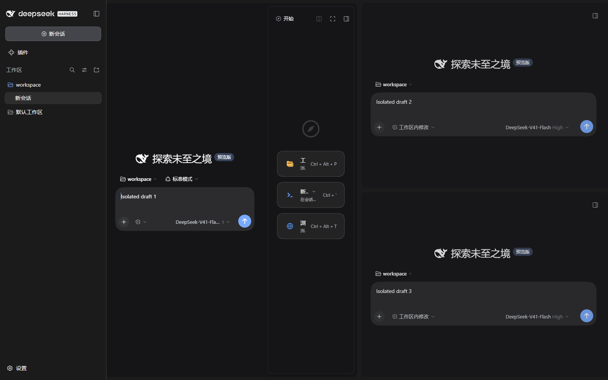
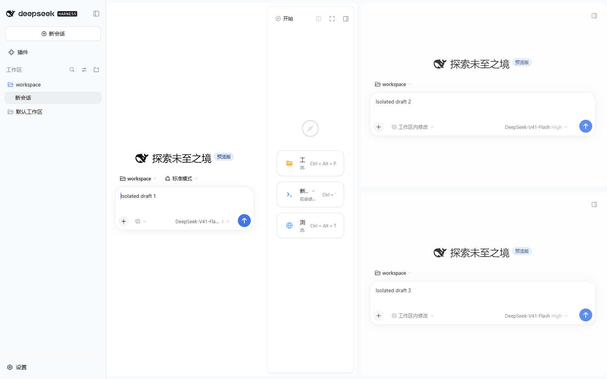

# 分屏统一改动验收

发布：0.5.0-rebuild.6（0.5.0-rebuild.6-f543522cfe6b）。

已安装到磁盘；当前 DSH 保持运行，下一次正常打开时生效，本次没有重启或热替换用户窗口。

- 移除重复会话标题和 Sidebar 标题，保留透明的 8px 拖拽热区，移除矩形焦点框；键盘聚焦只加强短线提示。工作区顶部和底部各留 8px 真实间距。
- Sidebar 使用 DSH 原生收起、全屏、还原控件，全屏仅占所属会话；关闭/移动分屏归入原生会话菜单。Sidebar 按冻结原型恢复 12px 圆角、1px、55% 原生边框色的轻边框，去除原生首列重复左边线、12px 内容间距与克制的静态阴影，并验证四个停靠方向。
- 分屏工作区与左侧栏共用原生底色；聚焦会话使用独立的原生内容底色，非聚焦会话略向工作区底色靠近，每个会话的外壳、聊天与 Sidebar 内部同色。非聚焦文字通过 16% 同底色蒙层淡化。深浅主题均验证三层颜色、焦点切换和无框透明拖拽热区。
- CSS Grid 直接处理内层尺寸；移除重复外层尺寸监听和逐像素全工作台广播，保留原生编辑器和 Sidebar 实例。

## 验收

101 项测试通过。五种隔离启动场景（原版、启用、完整冷启动恢复、禁用、缺少补丁）全部通过，运行时错误为 0。另验证四方向停靠、Sidebar 局部全屏、原生菜单移动/关闭、窄边缘拖拽取消、窄屏恢复、三个编辑器独立草稿及刷新恢复。关闭分屏不删除会话。

## 性能对比

实测背景色：

| 主题 | 原生左侧栏与右侧工作区 | 聚焦会话 | 非聚焦会话 |
|---|---|---|---|
| 深色 | `#1b1b1c` | `#151517` | `#171719` |
| 浅色 | `#f9fafb` | `#ffffff` | `#fdfdfd` |

左右底层的实际计算颜色完全相同。Sidebar 首列原生左边线实测为 0px，只保留外壳的轻边框；外围色强降到原生边框色的 55%，内部列分隔线未改动。

相同原生宿主、三个真实编辑器、每个会话 120 段合成文字，每项三轮，表中为脚本执行耗时中位数。

| 场景 | 稳定版 | 新版 | 降低 |
|---|---:|---:|---:|
| 分屏宽度拖拽 | 1150.18 ms | 126.78 ms | 89% |
| 会话内 Sidebar 调宽 | 852.98 ms | 97.03 ms | 88.6% |
| 左侧导航收展 | 445.08 ms | 135.86 ms | 69.5% |

测试期间电脑仍在使用，帧间隔受负载影响；本报告确认脚本开销下降及原生编辑器不重建，不承诺所有历史会话下的固定帧率。详细原始帧间隔与布局耗时见 visual-refinement.json。

启动证据：E:\dsh-plugin\dsh-split\rebuild-v5\releases\0.5.0-rebuild.6-f543522cfe6b\boot-validation.json

回退凭据：E:\dsh-plugin\dsh-split\rebuild-v5\backups\install-2026-10-16T09-24-24-199Z\receipt.json

